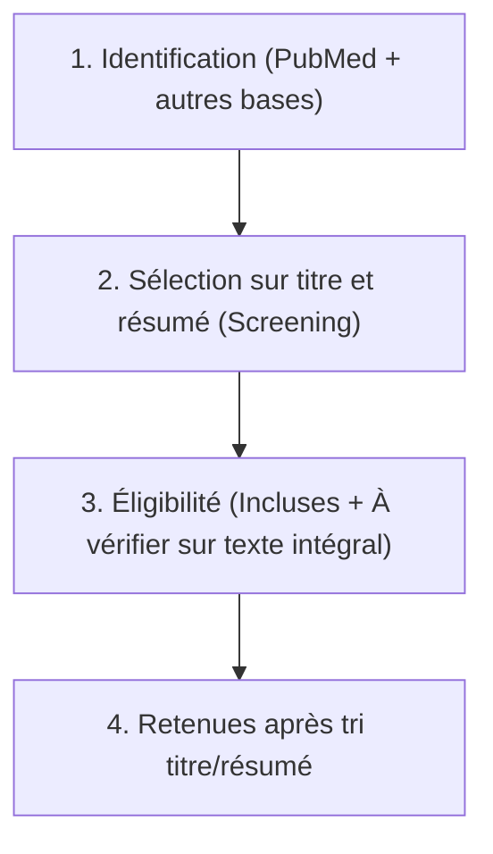

# MeSHcraft Studio — Guide des options et justifications méthodologiques

*Document de référence pour la formulation d'équations booléennes biomédicales et la conduite d'une revue systématique selon PRISMA 2020, PRISMA-S, PRESS et le Cochrane Handbook.*

---

## 1. Vue d'ensemble méthodologique

La stratégie documentaire constitue le socle scientifique d'une revue systématique de la littérature ou d'une thèse d'exercice. Un jury ou des relecteurs vérifient notamment :

1. **La sensibilité documentaire** : limiter le risque d'omettre des études pertinentes (silence bibliographique).
2. **La reproductibilité** : toute personne réexécutant l'équation à une date donnée doit retrouver le même corpus (traçabilité PRISMA-S).
3. **La conformité terminologique et structurale** : cadrage **PICO / PECO**, vocabulaire contrôlé **NLM MeSH / Emtree** et flux de sélection **PRISMA 2020**.

---

## 2. Formulation clinique : PICO / PECO et structuration assistée

### A. Les axes PICO / PECO et l'axe d'exclusion (`NOT`)

| Axe | Rôle technique | Justification méthodologique |
| :--- | :--- | :--- |
| **P — Population / Pathologie** | Définit la population cible ou l'entité clinique (ex. *Adultes atteints de diabète de type 2*). | Cadre le dénominateur de la revue. |
| **I / E — Intervention ou Exposition** | Définit le traitement, le dispositif, la chirurgie (PICO) ou le facteur d'exposition (PECO). | Variable d'intérêt principale. |
| **C — Comparateur** *(désactivé par défaut)* | Définit le groupe témoin (placebo, soins usuels, autre traitement). | **À n'activer que pour une comparaison directe explicite** : de nombreux résumés ne mentionnent pas « placebo » ou « soins standards », et inclure un comparateur passif dans l'équation génère du silence (recommandation Cochrane / PRESS). |
| **O — Critère de jugement (Outcome)** *(désactivable)* | Définit l'événement clinique ou le critère mesuré. | À activer pour contenir un volume trop large, ou à désactiver si les résultats sont rapportés sous des formulations hétérogènes dans les résumés. |
| **NOT — Exclusion clinique** *(optionnel)* | Exclut un concept en fin d'équation (`NOT (...)`). | À utiliser avec prudence : une exclusion `NOT` trop large peut supprimer des études comparatives mixtes pertinentes. |

### B. Assistant de structuration IA (texte libre)

Permet de saisir une question clinique ou un court paragraphe en français ou en anglais afin de pré-remplir les axes PICO/PECO sous forme de concepts atomiques concis. L'IA n'invente aucun descripteur MeSH : la résolution terminologique s'effectue à l'étape suivante contre **HeTOP / CISMeF** et **NCBI Entrez (`db=mesh`)**.

---

## 3. Stratégie de sensibilité et explosion MeSH

| Profil | Syntaxe générée | Usage recommandé |
| :--- | :--- | :--- |
| **Revue systématique (Sensible)** | `[Mesh]` avec explosion + synonymes et termes libres `[TiAb]` / `[tw]` | Recommandé pour une revue systématique exhaustive (rattrape les articles *In-Process* non encore indexés MeSH). |
| **Équilibré (Défaut)** | `[Mesh]` + synonymes usuels et troncatures contrôlées (≥ 5 caractères) | Compromis sensibilité/précision pour la majorité des revues cliniques. |
| **Spécifique (Ciblé)** | Sujets majeurs `[Majr]` + restrictions au titre | Utile sur des pathologies à très fort volume lorsqu'une première requête dépasse plusieurs milliers de notices. |

### Explosion MeSH (`[Mesh]` vs `[Mesh:NoExp]`)

Par défaut, un descripteur MeSH inclut automatiquement tous ses descendants hiérarchiques (« explosion »). L'option `[Mesh:NoExp]` (activable descripteur par descripteur à l'Étape 2) permet de restreindre la recherche au descripteur exact sans ses sous-branches.

---

## 4. Sous-rubriques MeSH (*Subheadings / Qualifiers*)

Les sous-rubriques (ex. `/drug therapy`, `/chemically induced`, `/adverse effects`, `/diagnosis`, `/mortality`) précisent la facette clinique d'un descripteur. L'application vérifie les sous-rubriques effectivement autorisées par la NLM (`ds_subheading`) pour chaque descripteur et applique la loi d'absorption booléenne afin d'éviter les syntaxes invalides ou redondantes.

---

## 5. Filtres méthodologiques et temporels

- **Exclusion animale Cochrane non destructive (activée par défaut)** :
  - Syntaxe générée : `NOT ("Animals"[Mesh] NOT "Humans"[Mesh])`.
  - **Justification** : contrairement au filtre strict `AND "Humans"[mh]`, cette formulation standard du *Cochrane Handbook* élimine les études exclusivement animales **sans exclure les articles récents *In-Process / Publisher*** qui n'ont pas encore reçu le descripteur `"Humans"[mh]`.
- **Filtre `"Humans"[mh]` strict** : disponible en option explicite, avec avertissement sur le risque de perte d'articles très récents non indexés.
- **Types d'études (`[pt]`)** : filtres optionnels pour cibler les essais contrôlés randomisés ou les revues systématiques / méta-analyses.
- **Bornes temporelles (`[dp]`)** : période personnalisable par année ou date exacte (`("YYYY/MM/DD"[dp] : "YYYY/MM/DD"[dp])`), traduite automatiquement au format natif Embase (`[DD-MM-YYYY to DD-MM-YYYY]/pd`).

---

## 6. Traduction multi-bases (PRISMA-S)

Une revue systématique conforme à PRISMA 2020 implique d'interroger plusieurs bases complémentaires afin d'éviter le biais de base unique (*PubMed-only bias*). MeSHcraft Studio génère simultanément :

1. **PubMed / MEDLINE (NLM)** : `"Descriptor"[Mesh]`, `"Descriptor/subheading"[Mesh]`, `"term"[TiAb]`, `"drug"[tw]`, troncatures `>= 5` caractères.
2. **Embase.com (Elsevier / Emtree)** : `'descriptor'/exp` (ou `/de`), `('term1' OR 'term2'):ti,ab,kw,de`, bornes `/pd`.
3. **Cochrane CENTRAL (Wiley)** : `[mh "Descriptor"]` (ou `[mh ^"Descriptor"]`), `("term1" OR "term2"):ti,ab,kw`.

---

## 7. Audit de conformité PRESS et vérification PubMed en direct

À l'Étape 2, l'équation est exécutée en direct sur PubMed (`esearch.fcgi` en `POST` pour lever toute limite de longueur d'URL) et soumise à des contrôles déterministes (équilibre parenthèses/guillemets, longueur des troncatures, couverture des concepts PICO, volume) complétés par une revue qualitative sur un échantillon stratifié (Tête / Milieu / Queue).

### Statut PRESS à 3 niveaux

- **Conforme (`compliant`)** : contrôles techniques valides, volume exploitable (`1` à `2 500` notices) et aucune alerte `warning` active.
- **À affiner (`needs_refinement`)** : au moins une observation de sévérité `warning` ou un volume supérieur à **2 500 notices** (risque de bruit élevé au dépouillement).
- **Révision requise (`revision_required`)** : effectif nul (`0` notice), erreur PubMed ou défaut technique bloquant (ex. erreur de syntaxe ou concept majeur absent).

### Niveaux de sévérité des observations

- **`ok`** : point conforme aux recommandations PRESS / Cochrane.
- **`info`** : remarque informative ou point de vigilance pour l'étape de tri (ex. présence normale de revues ou d'études hétérogènes dans la strate Queue d'une équation sensible) — ne bloque jamais le statut `Conforme`.
- **`warning`** : défaut objectif et corrigible dans l'équation (concept manquant, opérateur `NOT` trop restrictif, terme bruitant).

---

## 8. Diagramme de flux PRISMA 2020 et évaluation critique

- Conformément au *Cochrane Handbook*, toute notice sans résumé ou ambiguë au stade titre/résumé est classée **`À vérifier` (`maybe`)** et jamais exclue d'office.
- Le pré-repérage du risque de biais à l'Étape 4 fournit des indicateurs préliminaires sur titre/résumé (en priorisant les `<PublicationType>` officiels NLM et en marquant les revues narratives / recommandations comme `Hors grille (N/A)`) ; la cotation finale (RoB 2, ROBINS-I, AMSTAR 2) requiert la lecture des textes intégraux.

---

## 9. Parcours applicatif et outils de la barre supérieure

### Les 4 étapes du parcours guidé

1. **Question & PICO** : cadrage PICO/PECO, options de sensibilité, filtres et période.
2. **MeSH & Équations** : descripteurs validés HeTOP/NLM, équations PubMed / Embase / CENTRAL, contrôle des PMIDs repères (*gold standard*) et audit PRESS.
3. **Sélection & Rayyan** : chargement à la demande des résumés PubMed (jusqu'à 2 500 notices exhaustives), tri manuel ou pré-dépouillement IA par tranches de 50 notices, export/import bidirectionnel **Rayyan / Zotero** (`.ris` et `.csv`).
4. **Synthèse & Thèse** : diagramme PRISMA 2020, pré-repérage du risque de biais par lots de 20, matrice de synthèse (export `.csv` / Markdown) et chapitre **Matériel & Méthodes** (`.md`).

### Outils de la barre supérieure

| Contrôle | Fonction |
| :--- | :--- |
| **FR / EN** | Bascule la langue de l'interface. |
| **Mes revues** | Ouvre le tiroir de gestion des revues : auto-sauvegarde anti-F5 dans `IndexedDB`, sauvegarde/reprise complète sans ré-interroger les API, export et import portable au format `.json`, réinitialisation pour une nouvelle revue. |
| **Paramètres & API** | Configure le fournisseur IA (Google Gemini, OpenAI ou Anthropic), les deux modèles (analyse et lots), le cadencement de dépouillement, ainsi que les accès optionnels **NCBI PubMed** et **HeTOP / CISMeF**. Toutes les clés restent stockées exclusivement dans le navigateur. |
